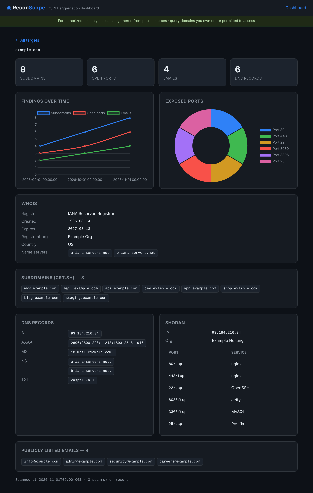

# ReconScope — OSINT Aggregation Dashboard

A Flask web application that aggregates **publicly available** intelligence
about a domain into a single dashboard. It queries several open sources,
stores every scan in SQLite, and visualizes how a target's exposure changes
over time with Chart.js — the kind of consolidated view a threat-intelligence
analyst works from, instead of a one-off command-line script.

> **For authorized use only.** Every source here is public, but you should only
> run reconnaissance against domains you own or are explicitly permitted to
> assess. The UI carries this notice on every page.

## What it does

For a given domain, ReconScope collects:

| Source | What it gathers | Needs a key? |
| --- | --- | --- |
| **WHOIS** | Registrar, creation/expiry dates, name servers, registrant org/emails | No |
| **crt.sh** (Certificate Transparency) | Subdomains that have appeared in TLS certificates | No |
| **DNS** | A, AAAA, MX, NS, TXT records | No |
| **Shodan** | Exposed ports and services on the primary IP | Yes (optional) |
| **Email harvest** | Email addresses publicly listed on the homepage | No |

Every scan is saved, so the dashboard can chart **trends** — new subdomains
appearing, a port becoming exposed, more addresses leaking — which is exactly
the drift a defender wants to catch.

## Screenshot

The target detail view: summary cards, a trend line across scans, an exposed-port
breakdown, and the full per-source findings. (Running on built-in demo data.)



## Architecture

```
app.py          Flask routes (dashboard, scan, target detail, chart API)
collectors.py   one function per OSINT source; each fails soft and returns
                a uniform {ok, data, error} dict
database.py     SQLite storage — targets + scans, with extracted counts
                for fast trend charts
seed_demo.py    loads realistic sample data so the UI works offline
templates/      Jinja2 templates (base, dashboard, target detail)
static/         dark-theme CSS + a vendored copy of Chart.js (no CDN needed)
```

**Design choice worth noting:** each collector returns `{ok, data, error}` and
never raises. If Shodan has no API key or crt.sh times out, that one panel shows
"unavailable" and the rest of the scan still completes. One dead source never
takes down the whole report.

## Setup

```bash
# 1. install dependencies
pip install -r requirements.txt

# 2. (optional) load demo data so the dashboard isn't empty
python3 seed_demo.py

# 3. run
python3 app.py
# open http://127.0.0.1:5000
```

To enable the Shodan panel, set an API key before running:

```bash
export SHODAN_API_KEY="your-key-here"   # Windows: set SHODAN_API_KEY=...
```

Without a key, every other source still works; the Shodan panel simply reports
that no key is set.

## Usage

1. Open the dashboard and enter a domain you are authorized to assess.
2. ReconScope runs all collectors and saves the result.
3. You land on the target's detail page: summary cards, charts, and findings.
4. Re-scan the same domain later — the trend chart now shows the change between
   scans.

## How the trend tracking works

Each scan stores the full result as JSON plus four extracted counts
(subdomains, open ports, emails, DNS records). The `/api/target/<id>/trends`
endpoint returns those counts as a time series, and Chart.js plots them. Storing
the counts alongside the JSON means the charts render without re-parsing every
historical scan on each page load.

## Limitations & notes

- **Rate limits.** crt.sh and Shodan rate-limit heavy use; this tool is built
  for occasional, authorized scans, not bulk crawling.
- **WHOIS variance.** Registrars return WHOIS in inconsistent formats, and many
  now redact registrant details under privacy rules, so some fields may be empty.
- **Email harvesting is shallow.** It reads only the homepage, by design — it is
  a demonstration of the concept, not an aggressive crawler.
- **Legal/ethical.** Reconnaissance against systems you do not own or have
  permission to test may be unlawful. Keep to your own assets or an explicit
  engagement scope.

## Requirements

- Python 3.8+ and the packages in `requirements.txt` (Flask, requests,
  python-whois, dnspython). Chart.js is vendored locally, so the dashboard
  needs no internet beyond the OSINT queries themselves.

## Author

Built by Mitul Nigam as a hands-on cybersecurity project demonstrating OSINT
aggregation, a Flask + SQLite web application, and data visualization for
security monitoring.
